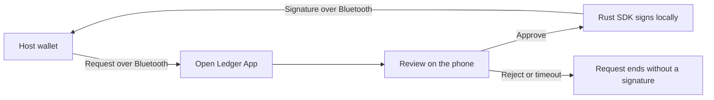

<p align="center">
  <picture>
    <source media="(prefers-color-scheme: dark)" srcset="branding/openledger-community-dark.svg">
    
  </picture>
</p>

<h1 align="center">Open Ledger App</h1>

<p align="center">
  <strong>Give an old phone a new role: a dedicated signing device.</strong><br>
  Building an open community around cold wallets, verifiable signing and self-custody.
</p>

<p align="center">
  <a href="README.zh-CN.md">中文</a> ·
  <a href="BUILDING.md">Build the app</a> ·
  <a href="CONTRIBUTING.md">Contribute</a> ·
  <a href="https://github.com/blockchain-dev-tools/open-ledger-app/issues">Issues & ideas</a> ·
  <a href="https://t.me/+3nh0Mgq1D7E5ZmJl">Telegram</a> ·
  <a href="https://x.com/LewisLLL1">X</a> ·
  <a href="SECURITY.md">Security</a>
</p>

---

Open Ledger App is an open-source experiment in turning an Android phone into a dedicated wallet signer. A host wallet prepares a request; the phone displays a confirmation and performs signing locally. The app implements a **Ledger Nano X-style BLE/APDU interface**, with Flutter for the interface and Rust for cryptography.

Our goal is to build a cold-wallet community where people can study the code, reproduce results, improve recovery and signing flows, and help make self-custody easier to understand.

> **Early-stage · Android first · Not independently audited.** Use disposable test wallets. The current transport is Bluetooth; there is no user-facing QR air-gap flow. A phone remains dependent on its operating system and does not provide a dedicated hardware wallet's security boundary. Read the [current security limitations](SECURITY.md) before trying the app.

## Why this project exists

- **Make use of hardware people already have.** Explore a dedicated signing role for an old phone, separate from the host wallet used to prepare transactions.
- **Make signing understandable.** Improve what the device shows before approval, how rejection works, and how people verify their backups.
- **Make claims reproducible.** Connect compatibility claims to a source revision, a build and an exact operation that someone else can test.
- **Build in the open.** Bring wallet users, device testers, designers, translators and developers into the same feedback loop.

The community we want to build contributes more than code: a clear recovery guide, a reproducible failed signing attempt or a better confirmation screen can all move the project forward.

## How it works



The host wallet and BLE peer are untrusted request sources. The device is responsible for parsing supported payloads and obtaining approval before releasing a signature. Public address/key queries are separate from signing. The app does not fetch balances or prices, or broadcast transactions.

Protocol compatibility and device security are separate questions. Implementing a Ledger-style interface does not establish compatibility with every host wallet, or equivalence to Ledger hardware. See the [product contract](docs/product/contract.md) for the intended behavior and known gaps.

## What you can explore today

| Area | In this source |
|---|---|
| Wallet setup | Create or import a BIP-39 wallet; optional passphrase; Enigma deterministic mnemonic derivation |
| Signing | BLE/APDU request handling, on-device approval/rejection, timeout handling and signing history |
| Recovery | PIN-gated local backup display and backup verification flows; recovery needs further validation |
| Android | Current development target; build from source using the linked instructions |
| iOS | Experimental integration scaffolding; not a validated end-to-end product |
| QR air-gap / USB | QR codecs exist without a product journey; USB is not implemented |

### Chain implementation is not a compatibility promise

| Chain | Protocol & crypto code | Current app entry points | Host-wallet verification |
|---|---|---|---|
| Ethereum | Present | Visible | Unverified for this source snapshot |
| Solana | Present | Visible | Unverified for this source snapshot |
| Tron | Present | Visible | Unverified for this source snapshot |
| Bitcoin | Present | Temporarily hidden pending validation | Unverified for this source snapshot |
| Sui | Present | Temporarily hidden pending validation | Unverified for this source snapshot |

The [verification matrix](docs/testing/ble-wallets.md) tracks what evidence a compatibility report needs. Service discovery or a successful address query alone does not establish signing compatibility.

### Security work still needed

The current source uses SharedPreferences storage with encrypted wallet secrets; extracted storage still allows offline guessing against the six-digit PIN. Background-lock handlers are not connected to the app lifecycle, a legacy seed route remains clipboard-capable, and Android release builds still use debug signing. These are open engineering problems. The full list and private reporting instructions are in [SECURITY.md](SECURITY.md).

## Join the community

Start with an [issue or proposal](https://github.com/blockchain-dev-tools/open-ledger-app/issues). Describe what you tried, what you expected and what you observed. You do not need to write Rust or Flutter to contribute.

| If you want to… | A useful first contribution |
|---|---|
| Test a phone or host wallet | Record the source commit, device/OS and host-wallet version, exact operation and result using the [verification matrix](docs/testing/ble-wallets.md) |
| Improve the experience | Review a setup, signing or recovery flow in the [design gallery](#preview-the-interface); propose a specific wording or interaction change |
| Improve documentation or translations | Clarify a confusing build/recovery step or improve the [app translations](apps/mobile-flutter/lib/ui/i18n/) |
| Work on protocols or cryptography | Add an independently sourced test vector or reproduce a gap in the [APDU corpus](spec/apdu/) |
| Improve security | Review the [trust model and known gaps](SECURITY.md); report vulnerabilities through the private reporting process |

For ordinary bug reports, include sanitized reproduction steps. Never post real seeds, PINs, passphrases, private keys, wallet storage dumps or personal device identifiers. Vulnerability details belong in the [security reporting process](SECURITY.md#reporting-a-vulnerability), not public issues.

Read [CONTRIBUTING.md](CONTRIBUTING.md) before opening a pull request. Small, reproducible contributions are welcome; discuss substantial behavior changes in an issue first.

## Where help matters most

These are contribution priorities, not release promises:

- **Strengthen the device boundary:** improve storage protection, connect lifecycle locking, remove the legacy clipboard exposure and establish release signing.
- **Measure interoperability:** publish reproducible per-operation results for named host-wallet versions, including rejection, timeout, disconnect and locked-state behavior.
- **Make recovery easier to verify:** test backup and restore with disposable wallets; improve explanations of passphrases and destructive reset.
- **Make participation easier:** improve first-build instructions, translations and the design gallery; validate a fresh clone on the documented toolchain.

## Build and explore

Use **Flutter 3.44.0 / Dart 3.12.0**, Rust stable, Java 17 and the Android SDK/NDK. Linux is the documented Android/E2E build host. Complete prerequisites, native-library packaging and platform limitations are in [BUILDING.md](BUILDING.md).

From the repository root, after configuring the toolchain:

```bash
rustup target add aarch64-linux-android
cargo test --locked --manifest-path crates/Cargo.toml
make build ARGS="--no-pull"
```

This builds a debug APK with the Rust library packaged inside. It is a development build; the release configuration is not ready for official distribution.

### Preview the interface

The standalone design gallery runs in a browser with mock data. It is useful for design and translation contributions and does not exercise native wallet signing or BLE.

```bash
cd apps/mobile-flutter
flutter --no-version-check --suppress-analytics pub get --enforce-lockfile
flutter --no-version-check --suppress-analytics run \
  -t tool/gallery/main.dart -d chrome
```

Flutter analysis, unit tests, real-FFI checks and device setup are documented in [BUILDING.md](BUILDING.md). For BLE signing tests, start with the [real-device E2E harness](apps/mobile-flutter/tool/e2e/README.md).

## Explore the source

```text
apps/mobile-flutter/    Flutter app, native projects, tests and design gallery
crates/                Rust cryptography, chain logic and C FFI
spec/apdu/             APDU command coverage and conformance vectors
docs/                  Product contract, protocol and testing references
```

Runtime cryptography lives in Rust. Root Node dependencies serve only the independent host-side E2E verifier. This repository contains the device app and SDK; the website and debugger are maintained separately.

| To understand… | Read |
|---|---|
| Product behavior and trust boundaries | [Product contract](docs/product/contract.md) |
| Credentials and encrypted storage | [Storage model](docs/reference/storage-state.md) |
| Device communication | [BLE/APDU transport](docs/reference/ble.md) |
| Deterministic mnemonic derivation | [Enigma](docs/reference/enigma.md) |
| Session and request behavior | [State machines](docs/reference/state-machines.md) |
| Code organization and change rules | [Architecture rules](AGENTS.md) |

## License and provenance

Project code uses the [MIT license](LICENSE). Fonts, assets and dependencies retain their own terms; see [third-party notices](THIRD_PARTY_NOTICES.md).

This standalone repository was prepared from curated source snapshots with a new Git history. It does not contain the original development history.

Ledger names describe protocol compatibility. Open Ledger App is an independent project and is not an official Ledger product.
