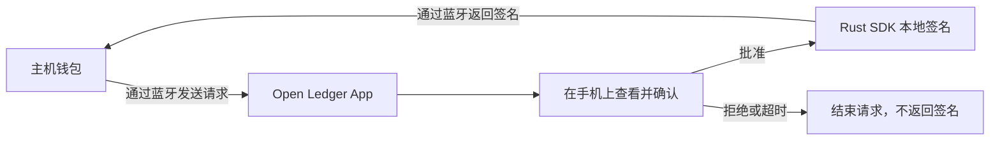

<p align="center">
  <picture>
    <source media="(prefers-color-scheme: dark)" srcset="branding/openledger-community-dark.svg">
    
  </picture>
</p>

<h1 align="center">Open Ledger App</h1>

<p align="center">
  <strong>让旧手机，成为一台专用签名设备。</strong><br>
  一起建设围绕冷钱包、可验证签名与资产自托管的开源社区。
</p>

<p align="center">
  <a href="README.md">English</a> ·
  <a href="BUILDING.md">构建 App</a> ·
  <a href="CONTRIBUTING.md">参与贡献</a> ·
  <a href="https://github.com/blockchain-dev-tools/open-ledger-app/issues">问题与想法</a> ·
  <a href="SECURITY.md">安全说明</a>
</p>

---

Open Ledger App 探索将 Android 手机变成专用的钱包签名设备：主机钱包准备请求，手机显示确认内容并在本地完成签名。项目实现 **Ledger Nano X 风格的 BLE/APDU 接口**，由 Flutter 提供界面，Rust 负责密码学操作。

我们的目标是建设一个冷钱包社区：让更多人能够阅读代码、复现结果、改善恢复和签名流程，也让资产自托管更容易被理解。

> **早期开发 · Android 优先 · 未经独立安全审计。** 请使用可丢弃的测试钱包。当前通过蓝牙通信，尚无面向用户的 QR 空气隔离流程。手机仍依赖自身操作系统，不具备专用硬件钱包的安全边界。体验前请阅读[当前安全限制](SECURITY.md)。

## 为什么做这个项目

- **利用已有的设备。** 探索旧手机的专用签名用途，将签名设备与准备交易的主机钱包分开。
- **让签名更容易理解。** 改善确认前显示的信息、拒绝请求的交互，以及验证备份的方式。
- **让结论能够复现。** 每项兼容性结论都应对应明确的源码版本、构建产物和可重复测试的具体操作。
- **让更多人参与建设。** 钱包用户、设备测试者、设计师、翻译者和开发者，都能把实际体验转化为改进。

我们希望社区积累的不只是代码：一份清晰的恢复指南、一次能够复现的签名失败、一张更易读的确认界面，同样有价值。

## 如何工作



主机钱包和蓝牙对端都是不可信的请求来源。设备负责解析受支持的请求，并在获得批准后才释放签名。查询公开地址或公钥与签名是不同的操作。App 不查询余额、价格，也不广播交易。

协议兼容性与设备安全需要分别验证。实现 Ledger 风格的接口，并不代表兼容所有主机钱包，也不代表具有 Ledger 硬件的安全保障。预期行为与已知缺口见[产品契约](docs/product/contract.md)。

## 现在可以探索什么

| 方向 | 当前源码状态 |
|---|---|
| 钱包创建 | 创建或导入 BIP-39 钱包；可选 passphrase；Enigma 暗语确定性派生助记词 |
| 签名流程 | BLE/APDU 请求处理、设备端批准与拒绝、超时处理、签名历史 |
| 备份与恢复 | PIN 验证后的本地备份展示、备份验证流程；恢复行为仍需进一步验证 |
| Android | 当前开发目标，可按构建说明从源码构建 |
| iOS | 实验性集成工程，尚未完成端到端产品验证 |
| QR 空气隔离 / USB | 已有 QR 编解码代码，尚无产品流程；USB 未实现 |

### 有链实现，不等于已经兼容

| 链 | 协议与密码学代码 | 当前 App 入口 | 主机钱包验证 |
|---|---|---|---|
| Ethereum | 已有实现 | 可见 | 此源码快照尚未验证 |
| Solana | 已有实现 | 可见 | 此源码快照尚未验证 |
| Tron | 已有实现 | 可见 | 此源码快照尚未验证 |
| Bitcoin | 已有实现 | 暂时隐藏，等待验证 | 此源码快照尚未验证 |
| Sui | 已有实现 | 暂时隐藏，等待验证 | 此源码快照尚未验证 |

[验证矩阵](docs/testing/ble-wallets.md)说明了兼容性报告需要提供哪些证据。能够发现蓝牙设备或成功读取地址，不代表签名流程已经兼容。

### 仍需完成的安全工作

当前使用 SharedPreferences 存储，钱包秘密字段经过加密，但提取存储后仍可离线猜测六位 PIN。后台锁定处理尚未接入 App 生命周期，旧助记词路由仍支持剪贴板复制，Android release 构建仍使用 debug 签名。这些都是尚待解决的工程问题。完整列表与私密漏洞反馈方式见 [SECURITY.md](SECURITY.md)。

## 一起建设社区

从一个 [Issue 或提案](https://github.com/blockchain-dev-tools/open-ledger-app/issues)开始：说清楚你尝试了什么、期待什么、实际发生了什么。不必会写 Rust 或 Flutter，也能参与贡献。

| 你想参与的方向 | 可以从这里开始 |
|---|---|
| 测试手机或主机钱包 | 按[验证矩阵](docs/testing/ble-wallets.md)记录源码 commit、设备与系统、主机钱包版本、具体操作及结果 |
| 改善使用体验 | 在[设计画廊](#预览界面)检查创建、签名或恢复流程，提出具体的文案或交互改进 |
| 完善文档或翻译 | 解释一处难懂的构建或恢复步骤，或改善 [App 翻译](apps/mobile-flutter/lib/ui/i18n/) |
| 研究协议或密码学 | 补充有独立来源的测试向量，或复现 [APDU 测试语料](spec/apdu/)中的缺口 |
| 改善安全性 | 阅读[信任模型与已知问题](SECURITY.md)，通过私密反馈流程报告漏洞 |

普通问题请提供脱敏后的复现步骤。不要发布真实助记词、PIN、passphrase、私钥、钱包存储文件或个人设备标识。漏洞细节请走[安全反馈流程](SECURITY.md#reporting-a-vulnerability)，不要发到公开 Issue。

提交 PR 前请阅读[贡献说明](CONTRIBUTING.md)。欢迎小而清晰、能够复现的贡献；涉及较大行为变化时，先在 Issue 中讨论。

## 最需要社区参与的方向

以下是贡献重点，不是版本或发布日期承诺：

- **加强设备安全边界：** 改善存储保护、接入生命周期锁定、移除旧剪贴板出口，并建立正式发布签名流程。
- **积累互操作证据：** 按主机钱包版本和具体操作发布可复现结果，覆盖拒绝、超时、断连与锁定状态。
- **让恢复更容易验证：** 使用测试钱包验证备份与恢复，改善 passphrase 和破坏性重置的说明。
- **降低参与门槛：** 改善首次构建说明、翻译和设计画廊，在文档指定的工具链上验证全新克隆的构建流程。

## 构建与探索

需要 **Flutter 3.44.0 / Dart 3.12.0**、Rust stable、Java 17 和 Android SDK/NDK。文档以 Linux 为 Android/E2E 构建主机。完整前置条件、原生库打包与平台限制见 [BUILDING.md](BUILDING.md)。

配置好工具链后，在仓库根目录运行：

```bash
rustup target add aarch64-linux-android
cargo test --locked --manifest-path crates/Cargo.toml
make build ARGS="--no-pull"
```

这会构建包含 Rust 原生库的 debug APK，用于开发验证；当前 release 配置尚不具备正式分发条件。

### 预览界面

独立设计画廊使用模拟数据在浏览器中运行，适合设计评审和翻译贡献，不执行原生钱包签名或 BLE 通信。

```bash
cd apps/mobile-flutter
flutter --no-version-check --suppress-analytics pub get --enforce-lockfile
flutter --no-version-check --suppress-analytics run \
  -t tool/gallery/main.dart -d chrome
```

Flutter 静态分析、单元测试、真实 FFI 验证与设备配置见 [BUILDING.md](BUILDING.md)。测试蓝牙签名流程请从[真机 E2E 工具](apps/mobile-flutter/tool/e2e/README.md)开始。

## 阅读源码

```text
apps/mobile-flutter/    Flutter App、原生工程、测试与设计画廊
crates/                Rust 密码学、链业务与 C FFI
spec/apdu/             APDU 指令覆盖与一致性测试向量
docs/                  产品契约、协议与测试说明
```

运行时密码学在 Rust 中实现。根目录 Node 依赖仅供主机侧 E2E 独立验签使用。本仓库包含设备 App 与 SDK；网站和 debugger 独立维护。

| 想了解什么 | 从这里阅读 |
|---|---|
| 产品行为与信任边界 | [产品契约](docs/product/contract.md) |
| 凭据与加密存储 | [存储模型](docs/reference/storage-state.md) |
| 设备通信 | [BLE/APDU 协议](docs/reference/ble.md) |
| 确定性助记词派生 | [Enigma 暗语](docs/reference/enigma.md) |
| 会话与请求状态 | [状态机](docs/reference/state-machines.md) |
| 代码组织与修改规则 | [架构约束](AGENTS.md) |

## 许可证与源码来源

项目代码采用 [MIT 许可证](LICENSE)。字体、资源和依赖保留各自条款，见[第三方声明](THIRD_PARTY_NOTICES.md)。

本独立仓库由经过筛选的源码快照整理而成，使用重新建立的 Git 历史，不包含原项目的开发过程记录。

Ledger 名称用于描述协议兼容性。Open Ledger App 是独立项目，并非 Ledger 官方产品。
